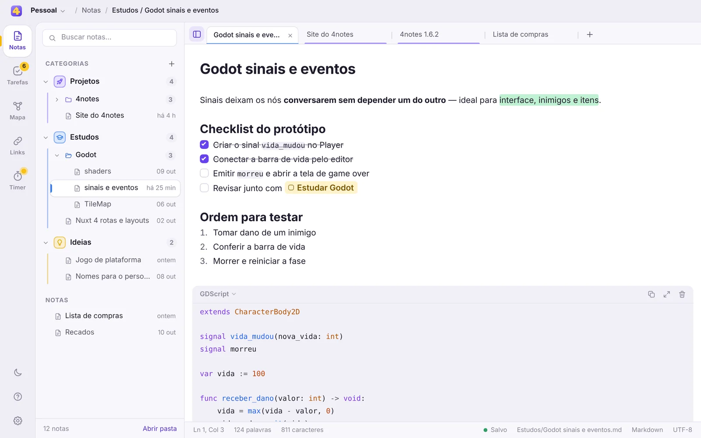
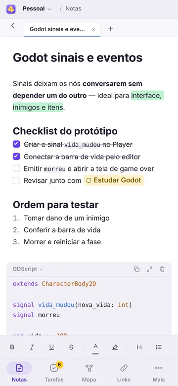
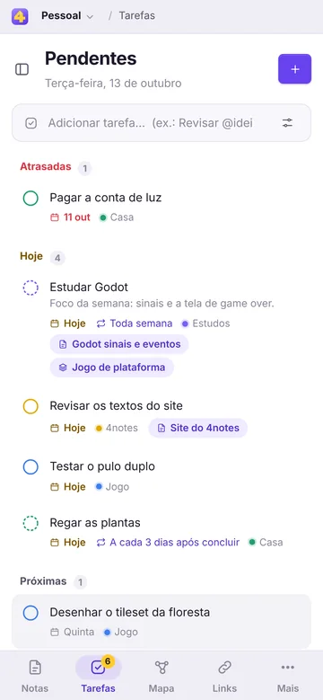
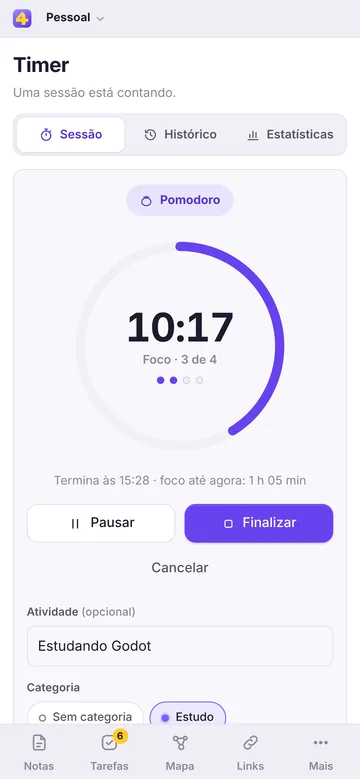

<div align="center">


# 4notes

### ✨ Você decide o que você precisa.

Notas, tarefas, mapas mentais, links e timer num só app.<br>
Ligue as ferramentas que fazem sentido para você, organize do seu jeito e guarde tudo numa pasta sua.

**Windows 10 e 11 · Android 7+ · sem conta e sem login**

[Baixar a versão mais recente](https://github.com/4kauanmota/4notes-app/releases/latest) ·
[Rodar o site](#rodar-no-computador) ·
[Publicar na Vercel](#publicar-na-vercel)

<br>



</div>

---

Este repositório é o **site de apresentação e download do 4notes** (Nuxt 4, gerado como site estático para a Vercel). O texto abaixo apresenta o app do mesmo jeito que o site; a parte técnica do site vem depois.

## 🧩 O 4notes é do seu jeito

O 4notes não impõe um método. Ele oferece cinco ferramentas e deixa a escolha com você:

- **Ligue só o que usa.** Cada módulo pode ser ativado ou desativado em Configurações › Módulos ou pelo botão direito do menu lateral. Desativar tira o módulo do menu, **sem apagar nenhum dado**, e ele volta como estava quando você religar.
- **Arrume o menu.** Mude a ordem dos módulos arrastando e escolha se o menu mostra só os ícones ou os ícones com os nomes.
- **Guarde onde quiser.** Você escolhe a pasta do workspace; tudo fica nela, em Markdown e JSON. Crie quantos workspaces quiser, cada um com seus dados e configurações.
- **Claro ou escuro.** O tema segue o sistema ou fica como você preferir.
- **Use no computador e no celular.** A mesma interface no Windows e no Android, adaptada a cada tela.

No site, a seção **“Monte o seu 4notes”** mostra isso na prática: ligue e desligue os módulos e veja o menu lateral mudar, como no app.

## 🛠️ As cinco ferramentas

| | Módulo | O que você ganha |
| :-: | --- | --- |
| 📝 | **Notas** | Anotações rápidas em abas, com formatação de verdade. Categorias com cor, ícone ou foto, pastas automáticas pelo título, atalhos para a versão anterior e a próxima de uma nota e exportação em TXT ou PDF. |
| ✅ | **Tarefas** | Datas, categorias e tarefas que se repetem. “Revisar amanhã #estudos” já define a data e a categoria, e a recorrência funciona mesmo com o app fechado. |
| 🧠 | **Mapa mental** | Ideias como notas ligadas entre si. Shift + arrastar conecta, soltar no vazio cria uma nota conectada e “Reorganizar” arruma o mapa evitando cruzamentos. |
| 🔗 | **Links** | Cole um endereço e o título e o ícone do site chegam sozinhos. Categorias, busca, ordenação e importação dos favoritos do navegador. |
| ⏱️ | **Timer** | Cronômetro, temporizador e Pomodoro, com histórico e estatísticas. A contagem vem do relógio, então trocar de módulo ou fechar o app não atrapalha. |

<div align="center">



</div>

## 🔗 Tudo se conecta, se você quiser

- **Menções com `@`**: numa nota ou tarefa, mencione notas, mapas, tarefas, links salvos e registros do Timer. Um clique abre o item no módulo dele, e renomear pelo app corrige as menções.
- **Editor sem símbolos na tela**: negrito, marca-texto, cores, listas que se renumeram, checklists, blocos de código coloridos e imagens coladas. O arquivo continua sendo Markdown comum.
- **Tutoriais com `F1`**: o tutorial do módulo abre ao lado, sem tirar você do que está fazendo.
- **Atualizações pelo próprio app**: quando sai uma versão nova, o 4notes avisa e instala quando você quiser.

## 📁 Seus dados são arquivos seus

Sem conta, sem login e sem servidor: o 4notes lê e grava só a pasta que você escolheu. Backup é copiar a pasta, e os arquivos abrem em qualquer editor de texto. Cada arquivo é gravado por inteiro, excluir manda para a Lixeira e as ações mais comuns têm Desfazer.

---

# 🌐 Sobre este site

## O que tem na página

Uma página só, em português, com tema claro e escuro (segue o sistema; o botão da lua/sol troca e a escolha fica guardada no navegador). O slogan **“Você decide o que você precisa”** abre a página e guia o resto: a seção logo abaixo deixa o visitante montar o próprio 4notes, e as outras mostram as ferramentas que ele pode escolher.

| Seção | O que mostra |
| --- | --- |
| **Abertura** | A marca (o canto do “4” dobra ao abrir a página), o slogan com um traço amarelo que se estende, os botões de download e o app de verdade: a janela do computador e o celular. |
| **Monte o seu 4notes** (`#do-seu-jeito`) | Os cinco módulos com switches iguais aos das Configurações do app, combinações de exemplo (Só anotar, Estudos, Projetos, Tudo) e a escolha entre “Ícone e nome” e “Só o ícone”. A prévia do menu lateral liga e desliga cada módulo com a animação de conectar; no celular ela vira a barra de baixo, como no app. Pelo menos um módulo fica ligado, como no app. |
| **Módulos** (`#modulos`) | Uma ferramenta de cada vez, com captura real, para que serve e o que dá para fazer. Alterna entre **Computador** e **Celular**. Dá para trocar de módulo pela lista, pelas setas do teclado ou clicando no menu lateral da própria captura. |
| **Recursos** (`#recursos`) | Editor sem símbolos, o app no celular e no dobrável, e uma comparação claro × escuro que se arrasta. |
| **Menções e dados** (`#conexoes`, `#seus-dados`) | O `@` que liga os módulos (captura real da lista de menções) e a pasta do workspace com os arquivos. |
| **Baixar** (`#baixar`) | Windows e Android: requisitos, tamanho do arquivo, como instalar e as novidades da versão. |
| **Encerramento e rodapé** | Chamada final (“é só ligar outro módulo”) e o slogan como assinatura no rodapé. |

Todas as capturas são do **4notes de verdade** (a interface compilada a partir do código do app), com um workspace de demonstração — nada desenhado à mão. A prévia do menu na seção “Monte o seu 4notes” é uma demonstração interativa feita no site, não uma captura.

## Rodar no computador

Requisitos: **Node.js 22.12+**.

```bash
npm install
npm run dev        # http://localhost:3000, com recarregamento automático
```

Para ver a versão final, igual à publicada:

```bash
npm run build      # gera o site estático em .output/public
npm run preview    # serve a pasta gerada (npx serve)
```

`npm run typecheck` confere os tipos (TypeScript estrito).

## Publicar na Vercel

1. Suba esta pasta para um repositório no GitHub (o `.gitignore` já deixa de fora `node_modules`, `.nuxt`, `.output` e `.vercel`).
2. Na Vercel: **Add New… › Project**, escolha o repositório e confirme. O `vercel.json` já define o framework (Nuxt) e o comando (`npm run build` = `nuxt generate`). Não é preciso configurar diretório de saída: o Nuxt detecta a Vercel e gera o formato que ela espera.
3. Pronto. Cada `git push` na branch principal publica uma versão nova.

**Domínio próprio (opcional).** O endereço usado no link canônico e na imagem de compartilhamento (`og:image`) vem sozinho do domínio de produção da Vercel. Se você ligar um domínio próprio, crie a variável de ambiente `NUXT_PUBLIC_SITE_URL` (ex.: `https://4notes.app`) em **Settings › Environment Variables** e publique de novo.

## Links de download

Tudo fica em **`app/config/downloads.ts`**:

- `githubRepo: '4kauanmota/4notes-app'` — o mesmo repositório que o app usa para se atualizar. Ao abrir a página, o site pergunta ao GitHub qual é a versão mais recente e os botões passam a apontar para o `.exe` e o `.apk` dela. **Publicou uma versão com `npm run release` no 4notes? O site já mostra a nova**, sem precisar publicar o site de novo.
- `fallback` — a versão conhecida (hoje a **1.6.2**, com os links, tamanhos e notas da versão). É o que vai no HTML gerado e o que vale se o GitHub não responder. Atualize de vez em quando.
- `platforms` — os textos de cada opção (requisitos, descrição, ajuda).

Para usar outro endereço de download, preencha `url` em `fallback.windows` / `fallback.android` e deixe `githubRepo` vazio. Sem `url`, o botão aparece desativado com “em breve”.

> A API do GitHub permite 60 consultas por hora por endereço de IP sem login. Passou disso, o visitante vê os dados do `fallback` — por isso vale mantê-lo em dia.

## Trocar as capturas

As imagens ficam em `public/screens/` e a lista (com o texto alternativo de cada uma) em **`app/config/screens.ts`**. Nome dos arquivos: `<id>-<light|dark>-<largura>.webp`, em WebP.

| Grupo | Arquivos | Tamanho original | Larguras geradas |
| --- | --- | --- | --- |
| Computador | `desktop-notes`, `desktop-tasks`, `desktop-mindmap`, `desktop-links`, `desktop-timer`, `desktop-timer-session`, `desktop-settings` | janela de 1280 × 800, em 2× (2560 × 1600) | 960, 1600, 2560 |
| Celular | `phone-notes`, `phone-note`, `phone-tasks`, `phone-mindmap`, `phone-links`, `phone-timer` | tela de 390 × 844, em 3× | 360, 720 |
| Dobrável aberto | `fold-notes` | tela de 690 × 830, em 2× | 690, 1380 |
| Recortes | `crop-editor` (barra de formatação), `crop-mention` (lista do `@`) | recortes da janela em 2× | 765/1530 e 555/1110 |

Para trocar, gere o mesmo enquadramento nos dois temas e substitua os arquivos mantendo os nomes. Os botões dos módulos no menu lateral das capturas do computador precisam continuar no mesmo lugar (as áreas clicáveis estão em `RAIL_HOTSPOTS`, em `app/config/modules.ts`).

## Estrutura

```text
4notes-web/
├── app/
│   ├── app.vue                 Casca: cabeçalho, página, rodapé, tema e versão
│   ├── pages/index.vue         A página (ordem das seções)
│   ├── components/
│   │   ├── sections/           Uma seção por arquivo (Hero, Monte o seu 4notes, Módulos, Recursos, Dados, Baixar…)
│   │   └── ui/                 Marca, ícones, molduras, captura no tema certo, botão de download
│   ├── config/
│   │   ├── downloads.ts        Versão, links e textos de download
│   │   ├── modules.ts          Os cinco módulos (textos, descrições das Configurações e capturas)
│   │   ├── screens.ts          Lista das capturas e textos alternativos
│   │   └── site.ts             Título, slogan, descrição e seções
│   ├── composables/            Tema, versão do GitHub, entrada na tela
│   ├── lib/                    Ícones (os mesmos do app) e Markdown das notas de versão
│   └── assets/css/             tokens.css (as cores do app) e base.css
├── public/                     Capturas, ícones, imagem de compartilhamento, manifesto
├── nuxt.config.ts              Metadados, tema antes de desenhar, geração estática
└── vercel.json
```

## Identidade visual

O slogan oficial é **“Você decide o que você precisa.”** Ele fica em `app/config/site.ts` (`site.slogan`, usado no rodapé; o título da página e a descrição também o trazem) e aparece em destaque na abertura. No resto do site a ideia aparece em ações, não em repetição: escolher os módulos, alternar o tema, o menu e o aparelho.


O site usa os **mesmos tokens do app** (`app/assets/css/tokens.css` do 4notes: roxo para ações, amarelo para destaques, neutros puxando para o roxo, temas claro e escuro), a **mesma família tipográfica** (Segoe UI Variable no Windows; a fonte do sistema nos outros), os **mesmos ícones** (`app/lib/icons.ts`) e a **mesma marca**. O fundo pontilhado é o do Mapa Mental, e a lista de módulos imita o menu lateral do app, com o indicador amarelo. Nenhuma fonte, biblioteca de interface ou de ícones é baixada.

Duas diferenças pequenas, por acessibilidade: o cinza mais claro do texto (`--text-3`) ficou um pouco mais escuro no tema claro e os botões principais do tema escuro usam um roxo um pouco mais fechado, para o texto branco ter contraste suficiente.

## Acessibilidade e desempenho

- Navegação por teclado (link para pular ao conteúdo, foco visível, setas na lista de módulos e na comparação claro × escuro), textos alternativos em todas as capturas e contraste AA conferido com o axe nos dois temas.
- “Reduzir movimento” do sistema desliga as animações (a dobra da marca, o traço do slogan, a entrada das telas, o encaixe dos módulos no menu e a pasta que aparece linha a linha).
- O HTML gerado já traz todo o conteúdo; o JavaScript entra para a escolha e a troca de módulos, o tema e a consulta da versão mais recente. Imagens em WebP com tamanhos responsivos e carregamento sob demanda, sem fontes externas.
